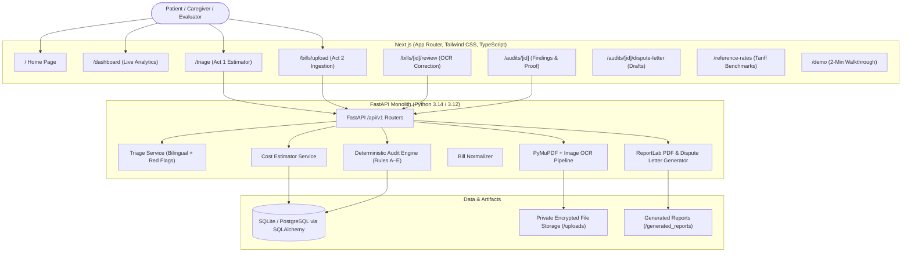

# MEDSURE Architecture & Technical Specification

**Tagline:** Know the Fair Price. Verify Every Bill.  
**Hindi:** सही दाम जानो। हर बिल जांचो।  
**Platform:** Patient-First Cost Transparency & Medical Bill Auditing  

---

## 1. Architectural Philosophy

> **Core Principle:** *AI understands. Deterministic rules decide. Every calculation is verified.*

Medical financial decisions demand absolute mathematical precision and legal auditability. MEDSURE decouples natural language symptom interpretation and document vision from financial calculations:
- **Natural Language & Vision (AI/OCR):** Normalizes user queries in English & Hindi, extracts tabular OCR text from PDF/image invoices, and identifies medical specialties and candidate procedures.
- **Deterministic Engine:** Recalculates multiplication totals using Python `Decimal` arithmetic, compares charges against official tariff ceilings (e.g., CGHS and NPPA implant caps), and flags candidate duplicates or unbundling without hallucinating figures.

---

## 2. System Architecture Diagram

---

## 3. Data Flow

### ACT 1 — Before Admission
1. User enters symptoms in English or Hindi (e.g. *"मेरे घुटने में बहुत तेज दर्द है"*).
2. `TriageService` screens for emergency red flags (chest pain, shortness of breath, sudden paralysis). If found, urgent emergency guidance is displayed immediately.
3. Clinical specialty (e.g., Orthopedics) and candidate procedure (e.g., `PROC-KNEE-TKR-01`) are mapped.
4. `CostEstimatorService` queries the versioned reference rate dataset for matching facility standards (NABH/CGHS/Standard).
5. Deterministic lower bound, expected median, and ceiling bounds are computed and plotted on Recharts.

### ACT 2 — After Discharge
1. User uploads a PDF or image medical bill.
2. File hash (SHA-256) is calculated for duplicate upload detection.
3. Native PDF text is extracted with PyMuPDF, or OCR is applied for scanned documents.
4. `BillNormalizer` converts lines into structured items: quantity, unit rate, claimed total, and confidence.
5. Patient verifies and corrects any OCR typos in the review screen.
6. `DeterministicAuditEngine` evaluates Rules A through E:
   - **Rule A (Arithmetic):** Recalculates `Qty × Rate = Total` using Decimal arithmetic.
   - **Rule B (Duplicate):** Identifies repeated one-time procedural items (e.g., double OT booking).
   - **Rule C (Reference-Rate):** Checks if charged rate exceeds official benchmark ceilings.
   - **Rule D (Unbundling):** Identifies items billed separately that are included in all-inclusive packages.
   - **Rule E (Completeness):** Flags zero-rate or missing quantities.
7. Findings are stored reproducibly in the database.
8. `ReportLab` generates a signed, tamper-evident PDF audit report and an editable dispute letter draft.
